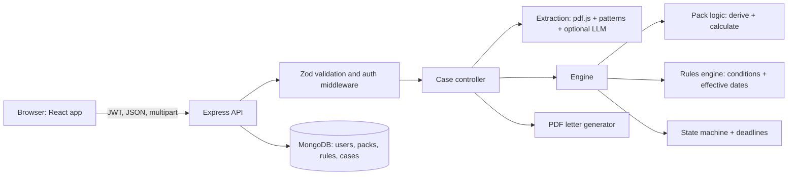

# HaqDaar

**Claim what you are legally owed.** HaqDaar reads your documents, checks them against the law and your agreements, estimates what you may be owed with the working shown, writes the formal letters and complaints, and tracks every deadline until you are paid.

- **Live app:** _add your Vercel link here_
- **API:** _add your Render link here_ (health check: `/api/health`)
- **Demo video:** _add your video link here_
- **Try it with sample documents:** [`demo-documents/`](demo-documents/) has made-up files for all three case types, with the expected results.

Built by **Samarth Patil**, Scaler School of Technology.

---

## Problem statement

Many people in India are owed money they never recover, even though the law is clearly on their side:

- An employee resigns and HR pays the final settlement late, leaves out gratuity, or deducts too much for notice. Under the Labour Codes in force since 21 November 2025, final wages are due within **two working days**, and fixed-term employees qualify for gratuity after one year.
- An airline cancels a flight at short notice and offers only a refund, although the DGCA rules (CAR Section 3, Series M, Part IV) require compensation of up to ₹10,000 on top.
- A tenant moves out and the landlord keeps part of the security deposit for "painting" or "damage", with no clause in the agreement and no bills to show for it.

People don't know the rule, can't calculate the amount, don't know whom to write to, and don't know where to escalate when nobody replies. So they give up, or pay an agent a large cut.

## Target users

Working professionals leaving a job, air travellers, and tenants moving out: anyone with a money claim but no lawyer.

## Solution

HaqDaar turns a legal right into four concrete things:

1. **Facts:** upload PDFs or paste text; AI extracts the facts into a typed form, and the user checks and confirms every one.
2. **Findings:** a rules engine (rules stored as data, with legal citations and effective dates) tests the facts.
3. **The amount:** a calculator per case type produces an itemised "owed vs offered" breakdown.
4. **Action:** a formal PDF letter for the right recipient, a ready-to-paste filing pack for government portals, and an escalation tracker with reply deadlines (HR → formal notice → SAMADHAN; airline → AirSewa → e-Jagriti; landlord → formal notice → Rent Controller or civil court).

The AI never decides anything. It only reads documents. Every conclusion comes from deterministic, testable code and rules that cite the law.

## Key features (core workflows)

1. **Open a claim and add documents:** PDF or text upload, AI extraction with a manual fallback, and low-confidence fields highlighted for review.
2. **Confirm facts:** typed, validated form generated from the case type's fact schema; required-field checks on the server.
3. **Analyse:** derived values (service years, working days, notice hours), rules in force on the case date, and the itemised calculation.
4. **Prepare:** preview and edit each letter, download it as a PDF, or, for portal stages, copy each field of the filing pack (with where it goes on the portal) and follow the step-by-step filing checklist.
5. **Send and track:** record how it was sent (email with Gmail/mail-app links, registered post, portal reference, by hand), watch the reply countdown, log replies and part payments (the outstanding amount updates), and escalate after a rejection, a part payment or a missed deadline. Each new letter refers to the earlier ones.
6. **Case file:** one PDF with the cover summary, calculation, findings, the full correspondence log and every letter, ready for a hearing.
7. **Admin rules:** admins create, edit and switch off rules, including their conditions and effective dates, with no redeploy.

Three case types are live: **job exit and final settlement**, **cancelled, delayed or overbooked flights**, and **rental deposit refunds**.

## Tech stack

| Layer | Technology |
|---|---|
| Frontend | React 18, Vite, Tailwind CSS, React Router, TanStack Query, Framer Motion, Lenis, three.js (React Three Fiber) |
| Backend | Node.js 22, Express, Mongoose, Zod, Multer, pdf.js (pdfjs-dist), PDFKit, JWT, bcrypt, Helmet, express-rate-limit |
| Database | MongoDB Atlas |
| AI | Optional, for document reading only: OpenRouter (default model Claude Haiku 5.5), Gemini or the Anthropic API. A built-in pattern reader works with no key. |
| Hosting | Vercel (frontend), Render (API) |

## Architecture



**Case packs.** Each area of law is a *pack*. Its fact schema and escalation stages are stored in MongoDB (`Pack`), its rules are stored in MongoDB (`Rule`), and its calculator and letter wording live in code (`server/src/services/packs/<key>`). Adding a new area means adding one pack folder and seed data. The core engine does not change.

**Key engineering decisions**

- **AI output is untrusted input.** It is parsed, validated with Zod, coerced to the schema types, stripped of unknown keys, and confirmed by the user before any rule runs. If the AI fails or isn't configured, the user types the facts in and everything else still works.
- **Rules are data with a safe condition language.** No `eval`. Conditions are JSON (`all`, `any`, `not`, comparison operators, and fact-to-fact comparisons), validated before an admin can save them.
- **Law changes over time.** Rules carry `effectiveFrom` and `effectiveTo`, and a case is judged by the rules in force on its reference date (for example, the last working day). Example: the two-working-day settlement rule applies to exits from 21 Nov 2025, while an older Payment of Wages Act rule covers earlier terminations.
- **The server enforces the case lifecycle.** A state machine (`draft → confirmed → letter_ready → awaiting_response → resolved/closed`) means the UI cannot put a case into an impossible state. Facts lock once a letter is sent.
- **Deadlines are computed on read, not by cron.** Free hosting sleeps idle servers, so a scheduled job could silently miss runs; computing on every read is always correct.
- **Privacy by design.** Uploaded files are held in memory only to extract text; the original file is never stored.
- **Ownership checks.** Users only ever see their own cases (other people's IDs return 404, not 403, so their existence isn't revealed). Admin routes require the `admin` role.

## Project structure

```text
server/
  src/config        env validation, DB connection
  src/models        User, Pack, Rule, Case
  src/middleware    auth, roles, validation, uploads, rate limits, errors
  src/routes        all API routes with Zod schemas
  src/controllers   auth, packs, cases, admin
  src/services      extraction, engine (rules, state machine, deadlines), packs, letters
  src/seed          packs and rules (with citations), idempotent seed script
  test/             unit tests for the engine and both packs (node --test)
client/
  src/pages         Landing, Auth, Dashboard, NewCase, CaseDetail, AdminRules, NotFound
  src/components    landing sections, case components, UI kit, 3D gem
  src/api           axios client and React Query hooks
demo-documents/     made-up documents for trying the app
```

## Local setup

Requirements: Node.js 22 or later and a MongoDB Atlas cluster (the free tier is enough). On macOS, port 5000 is used by AirPlay Receiver, so use `PORT=5001` and `VITE_API_URL=http://localhost:5001/api`.

```bash
# 1. API
cd server
cp .env.example .env        # then fill in the values (see below)
npm install
npm run seed                # creates case packs, rules and the admin account
npm run dev                 # http://localhost:5000/api/health
npm test                    # 27 unit tests

# 2. Frontend (new terminal)
cd client
cp .env.example .env        # VITE_API_URL=http://localhost:5000/api
npm install
npm run dev                 # http://localhost:5173
```

## Environment variables

**server/.env**

| Variable | Required | Description |
|---|---|---|
| `MONGODB_URI` | Yes | MongoDB Atlas connection string, with the database name, e.g. `.../haqdaar?retryWrites=true&w=majority` |
| `JWT_SECRET` | Yes | Random string of at least 32 characters |
| `CLIENT_ORIGIN` | Yes in production | Frontend URL(s), comma-separated, for CORS |
| `LLM_PROVIDER` | No | `openrouter`, `gemini`, `anthropic` or `none` (default; the pattern reader still runs) |
| `OPENROUTER_API_KEY` / `OPENROUTER_MODEL` | If using OpenRouter | Key from openrouter.ai; model defaults to `anthropic/claude-haiku-5.5` |
| `GEMINI_API_KEY` / `GEMINI_MODEL` | If using Gemini | Key from Google AI Studio (the project needs Gemini API access); model defaults to `gemini-3.8-flash` |
| `ANTHROPIC_API_KEY` / `ANTHROPIC_MODEL` | If using Claude | Anthropic API key and model |
| `ADMIN_EMAIL` / `ADMIN_PASSWORD` | No | Admin account created by `npm run seed` |
| `PORT`, `NODE_ENV`, `JWT_EXPIRES_IN` | No | Defaults: 5000, development, 7d |

**client/.env**

| Variable | Description |
|---|---|
| `VITE_API_URL` | API base URL including `/api` |

Secrets are never committed: `.env` files are git-ignored and only `.env.example` templates are in the repository.

## Deployment

**API on Render:** New → Blueprint → select this repository (uses `render.yaml`), or create a Web Service with root directory `server`, build command `npm ci`, start command `npm run seed && npm start`. Set `MONGODB_URI`, `CLIENT_ORIGIN` (your Vercel URL, e.g. `https://haqdaar.vercel.app`), `OPENROUTER_API_KEY`, `ADMIN_EMAIL` and `ADMIN_PASSWORD`; `JWT_SECRET` is generated for you. The free tier sleeps when idle, so the first request after a pause can take up to a minute; the app shows a "server is waking up" message.

**Frontend on Vercel:** import the repository, set the root directory to `client` (framework preset: Vite), and add `VITE_API_URL=https://<your-render-app>.onrender.com/api`. `vercel.json` handles client-side routing.

In MongoDB Atlas, allow network access from `0.0.0.0/0` so Render can connect.

## Legal sources encoded

- Code on Wages, 2019: s.17(2) (payment within two working days of exit), s.2(y) (definition of wages, 50% rule)
- Code on Social Security, 2020: s.53 (gratuity; fixed-term after one year)
- Payment of Wages Act, 1936: s.5(2) (for exits before 21 Nov 2025)
- Indian Contract Act, 1872: s.27 (restraint of trade), s.74 (reasonable compensation)
- DGCA CAR Section 3, Series M, Part IV (cancellation, denied boarding and delay)
- Rental deposits: the user's rental agreement and evidence; Indian Contract Act, 1872, s.73 (compensation only for actual loss); Model Tenancy Act, 2021, s.11 only where the user's state follows it. No state-specific deposit cap or refund deadline is assumed.

Figures were checked against public sources in October 2026. **HaqDaar gives guidance, not legal advice.**

## Limitations and next steps

- Working days skip weekends but not state public holidays.
- Leave encashment uses wages ÷ 26; company policies vary.
- Scanned (image-only) PDFs need the text pasted in; OCR is a planned addition.
- The rental deposit pack works from the user's agreement and evidence; it uses the Model Tenancy Act, 2021 only where the user's state follows it.
